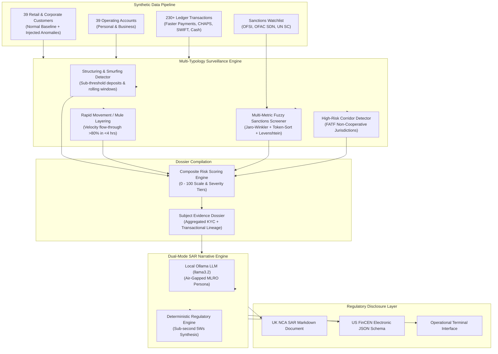

# Synthetic AML Transaction Monitoring & SAR Simulator

[](https://www.python.org/downloads/)
[-brightgreen.svg)]()
[]()
[]()

An enterprise-grade Anti-Money Laundering (AML) transaction monitoring, fuzzy sanctions screening, and automated Suspicious Activity Report (SAR) narrative generation engine. 

Engineered from the perspective of a **Chartered Banker (CCIBS)** and Financial Crime Specialist to demonstrate automated detection of complex financial crime typologies and regulatory narrative synthesis adhering strictly to **UK National Crime Agency (NCA)** and **US FinCEN** filing standards.

---

## 📌 Executive Problem Statement

Financial crime compliance departments at major banks and high-growth FinTechs face three critical operational bottlenecks:
1. **Alert Fatigue & Fragmented Detection:** Disparate monitoring systems evaluate structuring, velocity spikes, and sanctions hits in silos, leading to high false-positive rates and missed multi-typology layering.
2. **Name Matching Vulnerabilities:** Conventional exact-string screening fails to detect transliterated names, character substitutions, and inverted name orders ("First Last" vs "Last First") across international sanctions watchlists.
3. **Manual SAR Narrative Drafting:** Drafting an objective, legally sound 5Ws narrative (Who, What, Where, When, Why) for regulatory filing typically consumes 4 to 8 hours per investigation, creating massive backlog and regulatory risk.

**Solution:** This workstation runs **100% locally and deterministically**. It ingests transactional ledgers into SQLite, executes specialized multi-typology detection engines, performs multi-metric fuzzy sanctions matching, and compiles complete subject dossiers into publication-ready SAR narratives using either local air-gapped LLMs (`llama3.2`) or a structured deterministic engine.

---

## 🏗️ System Architecture



---

## 🛡️ Financial Crime Typologies & Detection Logic

### 1. Structuring / Smurfing (`STRUCTURING`)
- **Modus Operandi:** Deliberate fragmentation of large sums into multiple cash deposits or electronic transfers just below the statutory reporting threshold (£10,000 / $10,000).
- **Detection Algorithm:** Sliding temporal window (7 to 14 days) tracking transactions between 70% and 99.9% of statutory limit, plus cumulative cash deposit bursts exceeding reporting caps.
- **Risk Scoring:** Dynamically scales from 75 to 95 based on transaction count and threshold proximity.

### 2. Rapid Movement of Funds / Mule Layering (`RAPID_MOVEMENT`)
- **Modus Operandi:** Large inbound transfer (e.g. £54,000) followed almost immediately by rapid dispersion (>80% of funds) across multiple unrelated counterparties, characteristic of mule accounts.
- **Detection Algorithm:** Detects inbound credits $\ge$ £5,000 and calculates flow-through ratio (`outbound_sum / inbound_amt`) within tight velocity windows (2 to 12 hours).
- **Risk Scoring:** Assigns Critical severity (score up to 98.0) when dispersal velocity occurs within under 4 hours.

### 3. Multi-Metric Fuzzy Sanctions & PEP Screening (`SANCTIONS_PEP_MATCH`)
- **Modus Operandi:** Evasion of international sanctions lists (UK OFSI, US OFAC SDN, UN) through minor misspellings, alias usage, or name inversion.
- **Detection Algorithm:** Multi-layered string matching combining:
  1. **Token-Sort Similarity:** Handles inverted naming conventions (*"Bout Victor"* vs *"Victor Bout"*).
  2. **Jaro-Winkler Metric:** Heavily weights prefix consistency for phonetic and romanized variants (*"Viktor Butt"* vs *"Victor Bout"*).
  3. **Levenshtein Distance:** Normalizes insertion/deletion typographical errors.
- **Coverage:** Automatically screens both onboarding customer profiles and outbound transaction counterparty strings.

### 4. High-Risk Corridor Transfers (`HIGH_RISK_CORRIDOR`)
- **Modus Operandi:** Funds routed to or originating from jurisdictions classified by FATF as High-Risk (Black List) or Jurisdictions under Increased Monitoring (Grey List) (e.g., SY, KP, IR, MM).
- **Detection Algorithm:** Evaluates ISO country codes against sanctioned jurisdictional registries.

---

## 🚀 Quickstart & Usage

### Prerequisites
- Python 3.10+ (tested on Python 3.13)
- Optional: [Ollama](https://ollama.ai/) with `llama3.2` installed (`ollama pull llama3.2`) for local LLM-assisted SAR narrative synthesis.

### Installation
```bash
git clone https://github.com/KhaieJay1/aml-sar-simulator.git
cd aml-sar-simulator
pip install -r requirements.txt

# Generate synthetic dataset and seed the SQLite database
python data/generate_synthetic_aml_data.py
```

### CLI Command Reference

#### 1. Display Database Surveillance Metrics
```bash
python -m src.cli stats
```
```text
=== AML SURVEILLANCE & TRANSACTION MONITORING METRICS ===
Total Customers:            39
Total Accounts:             39
Total Ledger Transactions:  230
Synthetic Ground Anomalies: 12
Watchlist Sanctions:        7
Active Alerts in DB:        7
Filed SAR Records:          4
```

#### 2. Screen a Name Against Sanctions & PEP Watchlists
Demonstrate fuzzy matching on name variations and aliases:
```bash
python -m src.cli screen "Victor Butt"
```
```text
Screening name 'Victor Butt' against synthetic Sanctions & PEP Watchlist (Threshold: 0.75)...
[!] 1 Watchlist Hits Detected:

+-------------+-----------+---------------+--------------+--------------------------+--------------------------------------------------------+
| Entry ID    | Program   | Match Score   | Matched On   | Primary Name             | Listing Reason                                         |
+=============+===========+===============+==============+==========================+========================================================+
| UK-OFSI-001 | UK_OFSI   | 94.8%         | Viktor Butt  | Viktor Anatolyevich Bout | Illicit arms trafficking and weapons proliferation.... |
+-------------+-----------+---------------+--------------+--------------------------+--------------------------------------------------------+
```

Screening inverted names with token sort invariance:
```bash
python -m src.cli screen "Sergey Ivanoff"
```
```text
Screening name 'Sergey Ivanoff' against synthetic Sanctions & PEP Watchlist (Threshold: 0.75)...
[!] 1 Watchlist Hits Detected:

+--------------+-----------+---------------+---------------+---------------------------+-----------------------------------------------------------------+
| Entry ID     | Program   | Match Score   | Matched On    | Primary Name              | Listing Reason                                                  |
+==============+===========+===============+===============+===========================+=================================================================+
| OFAC-SDN-002 | OFAC_SDN  | 93.6%         | Sergey Ivanov | Sergei Sergeyevich Ivanov | Senior official in designated Russian financial and industri... |
+--------------+-----------+---------------+---------------+---------------------------+-----------------------------------------------------------------+
```

#### 3. Run Transaction Monitoring Surveillance Scan
Scan all transactions and output prioritized alert dossiers:
```bash
python -m src.cli scan
```
```text
[+] Scan completed. 7 suspicious activity alerts triggered:

+-----------------------------+------------+---------------------+---------------+--------------+-------------------------------------------------------------------+
| Alert ID                    | Severity   | Typology            | Customer ID   |   Risk Score | Description                                                       |
+=============================+============+=====================+===============+==============+===================================================================+
| ALT-TXSNC-CUST-AN-05344318  | CRITICAL   | SANCTIONS_PEP_MATCH | CUST-ANOM-CPS |        100.0 | Sanctions Hit on Counterparty (100.0%): Payment of £14,500.00 t... |
| ALT-RPM-CUST-AN-05344317    | CRITICAL   | RAPID_MOVEMENT      | CUST-ANOM-RPM |         98.0 | Rapid Passthrough / Mule Layering: Inbound £54,000.00 received ... |
| ALT-STR-CUST-AN-05344317    | HIGH       | STRUCTURING         | CUST-ANOM-STR |         95.0 | Structuring pattern detected: 4 transactions just below the £1... |
| ALT-SNC-CUST-AN-05344317    | CRITICAL   | SANCTIONS_PEP_MATCH | CUST-ANOM-SNC |         94.8 | Sanctions / PEP Watchlist Hit (94.8% match): Customer 'Victor ... |
| ALT-HRC-CUST-AN-05344318    | CRITICAL   | HIGH_RISK_CORRIDOR  | CUST-ANOM-CPS |         90.0 | High-Risk Corridor Transfer: Payment of £14,500.00 (INBOUND) i... |
| ALT-HRC-CUST-AN-05344318    | HIGH       | HIGH_RISK_CORRIDOR  | CUST-ANOM-CPS |         80.0 | High-Risk Corridor Transfer: Payment of £32,000.00 (INBOUND) i... |
+-----------------------------+------------+---------------------+---------------+--------------+-------------------------------------------------------------------+
```

#### 4. Generate Formal Suspicious Activity Report (SAR)
Draft a complete, 5Ws-compliant regulatory filing:
```bash
# Fast deterministic filing (sub-second)
python -m src.cli sar CUST-ANOM-RPM-02 --offline --output markdown --save sample_sars/sample_mule_layering_sar.md

# Air-gapped local LLM synthesis (via Ollama llama3.2)
python -m src.cli sar CUST-ANOM-RPM-02 --type UK_NCA_SAR --output markdown
```

---

## 📋 Sample Regulatory SAR Filing Output

Generated output adhering to the UK National Crime Agency (NCA) 5Ws filing framework:

```markdown
# UK_NCA_SAR Suspicious Activity Report
**Filing ID:** `SAR-20261020-RPM-02` | **Date:** `2026-10-20 17:36:18` | **Status:** `DRAFT`
**Drafting Engine:** `Deterministic SAR Narrative Engine`

## Executive Summary
| Field | Detail |
|---|---|
| **Subject Name** | Elena Rostova |
| **Subject ID** | `CUST-ANOM-RPM-02` |
| **Entity Type** | INDIVIDUAL |
| **Suspicious Amount** | **£104,000.00 GBP** |
| **Observed Timeframe** | 2026-10-11 to 2026-10-12 |
| **Typologies Detected** | RAPID_MOVEMENT, STRUCTURING |

---

## 5Ws Regulatory Narrative Breakdown

### 1. WHO (Subject Identity & KYC Profile)
Subject: Elena Rostova, DOB: 1996-03-22, Nationality: GB, Resident: GB. 
Occupation: Freelance Designer. Customer ID: CUST-ANOM-RPM-02. KYC Risk Rating: HIGH.

### 2. WHAT (Suspicious Modus Operandi & Typology Details)
- [RAPID_MOVEMENT] Rapid Passthrough / Mule Layering: Inbound £54,000.00 received and 
  92.6% (£50,000.00) dispersed across 5 outbound transfers within 0.4 hours.
- [STRUCTURING] Smurfing / Structured deposits detected: 6 deposits aggregating to 
  £104,000.00 exceeding reporting threshold within 7 days.

### 3. WHERE (Delivery Channels & Jurisdictions)
Accounts Involved: ACC-ANOM-RPM-02. Reporting Institution Jurisdiction: United Kingdom (GB). 
Counterparty Jurisdictions: GB.

### 4. WHEN (Chronology & Transaction Velocity)
Activity observed between 2026-10-11 to 2026-10-12 across 6 transactions.

### 5. WHY (Grounds for Suspicion & Commercial Inconsistency)
Immediate pass-through velocity with funds dispersed within hours to unrelated counterparties, 
consistent with money mule operations. Repetitive high-value deposits just below mandatory 
threshold indicating deliberate structuring.

### 6. HOW / DISPOSITION (Mitigating Action & Asset Restraint)
Internal automated transaction monitoring rules engine flagged atypical velocity and threshold deviations.
- Account placed on operational hold pending Law Enforcement / MLRO consent.
- Complete audit trail and counterparty identifiers preserved.
```

---

## 🧪 Testing & Verification

The test suite contains **21 unit and integration tests** verifying detector mathematical boundary conditions, temporal window sliding, fuzzy phonetic matching, composite name ranking, deterministic SAR generation, and CLI subcommands.

To run the complete test suite:
```bash
python -m pytest tests -v
```
```text
============================= test session starts =============================
platform win32 -- Python 3.13.3, pytest-9.1.1, pluggy-1.7.0
rootdir: ./aml-sar-simulator
collected 21 items

tests/test_cli.py::test_cli_stats PASSED                                 [  4%]
tests/test_cli.py::test_cli_scan PASSED                                  [  9%]
tests/test_cli.py::test_cli_screen_hit PASSED                            [ 14%]
tests/test_cli.py::test_cli_screen_clean PASSED                          [ 19%]
tests/test_cli.py::test_cli_sar_offline PASSED                           [ 23%]
tests/test_engine.py::test_monitoring_engine_full_scan PASSED            [ 28%]
tests/test_engine.py::test_subject_dossier_retrieval PASSED              [ 33%]
tests/test_high_risk_corridor.py::test_high_risk_corridor_flagged PASSED [ 38%]
tests/test_high_risk_corridor.py::test_standard_corridor_not_flagged PASSED [ 42%]
tests/test_rapid_movement.py::test_rapid_passthrough_mule_layering_detected PASSED [ 47%]
tests/test_rapid_movement.py::test_slow_retention_not_flagged PASSED     [ 52%]
tests/test_sanctions.py::test_exact_match PASSED                         [ 57%]
tests/test_sanctions.py::test_fuzzy_alias_match PASSED                   [ 61%]
tests/test_sanctions.py::test_transposed_name_matching PASSED            [ 66%]
tests/test_sanctions.py::test_clean_name_not_matched PASSED              [ 71%]
tests/test_sanctions.py::test_screen_customer_records PASSED             [ 76%]
tests/test_sar_generator.py::test_sar_generation_offline PASSED          [ 80%]
tests/test_sar_generator.py::test_sar_generation_invalid_customer PASSED [ 85%]
tests/test_structuring.py::test_structuring_detected PASSED              [ 90%]
tests/test_structuring.py::test_normal_transactions_no_structuring PASSED [ 95%]
tests/test_structuring.py::test_single_large_transaction_not_flagged_as_structuring PASSED [100%]

============================= 21 passed in 4.25s ==============================
```

---

## ⚖️ Scope, Synthetic Data & Limitations

- **100% Synthetic Banking Ledger:** All 39 customer records, 39 accounts, 230+ transactions, and 7 watchlist profiles (`data/generate_synthetic_aml_data.py` -> `data/aml_monitoring.db`) are synthetically generated for AML typology demonstration and contain zero real customer PII or banking data.
- **Deterministic vs. Production Calibration:** Typology rules (`structuring.py`, `rapid_movement.py`, `high_risk_corridor.py`) use transparent sliding-window thresholds (70%–99.9% of £10k over 7 days; >=80% passthrough within 12 hours). In a Tier-1 bank environment, static thresholds are paired with customer peer-group baselining, dynamic threshold tuning (above-the-line / below-the-line testing), and false-positive suppression.
- **Fuzzy Name Screening Scope:** The composite Jaro-Winkler (70%) + Levenshtein (30%) + Token-Sort scorer handles Latin-alphabet phonetic typos and transposed names; production cross-border screening additionally integrates Double Metaphone, Cyrillic/Arabic transliteration tables, and secondary identifier checks (DOB, passport, nationality) to suppress common-name false positives.

---

## 📁 Repository Structure

```text
aml-sar-simulator/
├── README.md                      # Executive documentation & technical architecture
├── requirements.txt               # Dependencies (pydantic, tabulate, requests, pytest)
├── .gitignore                     # Git exclusion rules
├── data/
│   ├── aml_monitoring.db          # Pre-seeded SQLite database (39 customers, 230+ txs)
│   └── generate_synthetic_aml_data.py # Synthetic data generation engine
├── src/
│   ├── __init__.py
│   ├── models.py                  # Pydantic data schemas & Enums
│   ├── db.py                      # SQLite database operations & indexing
│   ├── engine.py                  # Transaction Monitoring Surveillance Orchestrator
│   ├── sar_generator.py           # Dual-mode SAR narrative engine (Ollama + Deterministic)
│   ├── reporter.py                # Tabular, Markdown, and JSON report formatters
│   ├── cli.py                     # CLI entrypoint (stats, scan, screen, sar)
│   └── detectors/
│       ├── __init__.py
│       ├── structuring.py         # Sub-threshold deposit & smurfing detector
│       ├── rapid_movement.py      # High-velocity passthrough & mule detector
│       ├── sanctions_screening.py # Fuzzy matching engine (Jaro-Winkler + Token-Sort)
│       └── high_risk_corridor.py  # FATF high-risk jurisdiction detector
├── sample_sars/                   # Sample filed SAR documents
│   ├── sar_structuring_arthur_pendelton.md
│   ├── sar_mule_layering_elena_rostova.md
│   ├── sar_sanctions_hit_victor_butt.md
│   └── sar_sanctioned_counterparty_marcus_vance.md
└── tests/                         # Pytest test suite (21 unit & integration tests)
    ├── conftest.py
    ├── test_cli.py
    ├── test_engine.py
    ├── test_high_risk_corridor.py
    ├── test_rapid_movement.py
    ├── test_sanctions.py
    ├── test_sar_generator.py
    └── test_structuring.py
```

---

## 🔒 Confidentiality & Synthetic Data Notice

- **100% Synthetic Data:** All customer identities, transaction amounts, account numbers, and narratives are purely synthetic and programmatically generated.
- **Zero Confidential IP:** No non-public bank thresholds, proprietary banking lists, or customer data from previous financial institutions (Danske, NatWest, etc.) are used or replicated.
- **Air-Gapped & Secure:** Operates with complete zero external cloud exposure.

---

## 👤 Author

**Kayode J. Afuvape, CCIBS**  
*Chartered Banker (Chartered Banker Institute) | Financial Crime & AML Compliance | GRC Engineering*  
- **GitHub:** [KhaieJay1](https://github.com/KhaieJay1)  
- **Specializations:** Transaction Monitoring, Sanctions Screening, Typology Detection, UK NCA & US FinCEN SAR Filing, ISO 27001, DORA.
